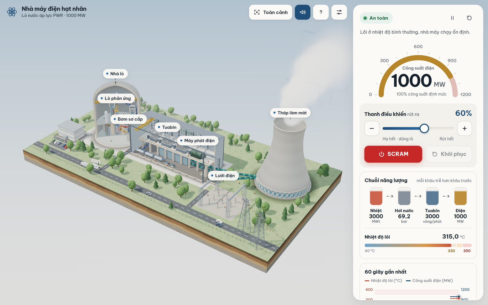
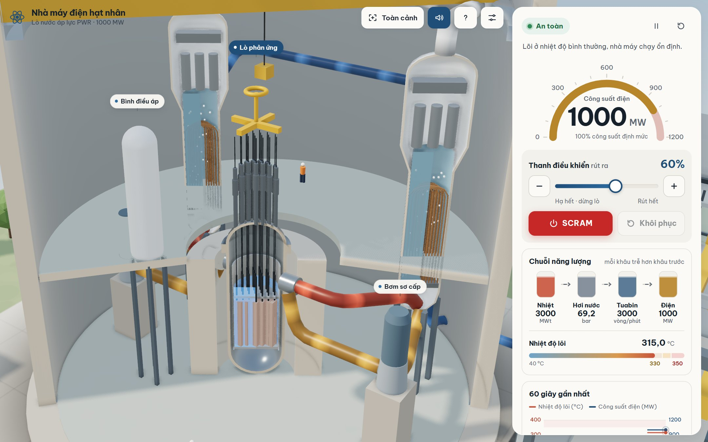
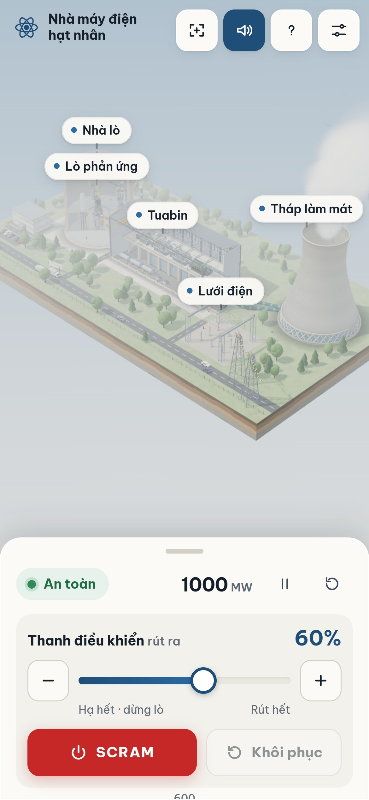
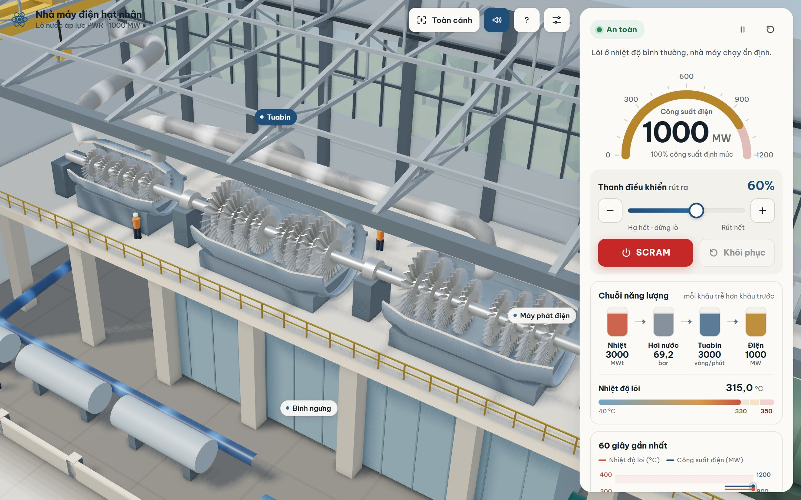
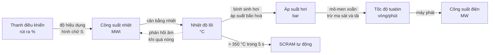

<div align="center">

# Nhà máy điện hạt nhân PWR · Mô phỏng 3D

**Tự tay điều khiển lò phản ứng nước áp lực và xem nhiệt biến thành hơi nước, tuabin quay và dòng điện chạy lên lưới.**

[](https://harieedawwn.github.io/nuclear-sim/)


**▶ https://harieedawwn.github.io/nuclear-sim/**



</div>

## Tính năng

- **Nhà máy 3D cắt lớp** chạy ngay trong trình duyệt: nhà lò bê tông với lớp lót thép và cầu trục, thùng lò có bó nhiên liệu, thanh điều khiển chuyển động thật, bình sinh hơi đang sôi, bình điều áp, bơm sơ cấp, gian tuabin với rôto quay, máy phát, bình ngưng, tháp làm mát có cột hơi nước và mưa bên trong, trạm biến áp và đường dây có dòng năng lượng chạy.
- **Dòng chảy đọc được ngay**: sơ cấp nóng màu đỏ cam, sơ cấp lạnh màu hổ phách, hơi nước màu trắng xám, nước cấp màu xanh lam, nước làm mát màu xanh ngọc. Tốc độ dòng theo đúng lưu lượng mô phỏng.
- **Ánh xanh Cherenkov** trong nước quanh lõi mạnh lên theo công suất nhiệt; lõi và nhánh nóng ấm lên theo nhiệt độ.
- **Chuỗi năng lượng** *Nhiệt → Hơi nước → Tuabin → Điện* ở bảng điều khiển: mỗi khâu trễ hơn khâu trước, học sinh thấy rõ độ trễ lan dần.
- **An toàn**: ba mức *An toàn / Cảnh báo / Nguy hiểm*, đèn xoay trên mái vòm, viền đỏ quanh lò, nút **SCRAM**, tự SCRAM sau 5 giây ở mức Nguy hiểm, nút **Khôi phục** khi lõi đã nguội.
- **Âm thanh chân thực tạo bằng thuật toán**: bơm, bước kẹp của cơ cấu truyền động thanh, hơi nước, tuabin, tiếng ù 50 Hz của máy phát, mưa trong tháp làm mát, chuông cảnh báo, còi nguy hiểm và chuông SCRAM.
- Chạm vào từng bộ phận để camera bay tới và hiện giải thích; biểu đồ 60 giây; hướng dẫn 4 bước cho lần đầu.
- **Chạy tốt trên điện thoại**, kể cả trình duyệt trong Zalo; tự chọn mức chất lượng theo máy và tự chuyển sang bản vẽ 2D nếu máy không chạy được 3D.

<table>
<tr>
<td width="62%"></td>
<td></td>
</tr>
<tr>
<td colspan="2"></td>
</tr>
</table>

## Cách dùng

**Trên điện thoại** (iPhone, Android, Zalo)
1. Mở đường link, chọn *Có âm thanh* hoặc *Không âm thanh*, bấm **Bắt đầu**.
2. Kéo thanh trượt *Thanh điều khiển* ở bảng phía dưới (hoặc kéo tay nắm vàng phía trên lò trong hình).
3. Vuốt thanh nhỏ ở mép trên bảng để mở rộng và xem chuỗi năng lượng, nhiệt độ lõi, biểu đồ.
4. Một ngón kéo để xoay, hai ngón chụm để phóng to. Chạm vào nhãn hay bộ phận để xem giải thích; nút góc trên quay về toàn cảnh.

> Trên iPhone, nếu không nghe thấy tiếng, hãy gạt công tắc im lặng sang chế độ có chuông. Trong Zalo, nên chọn *Mở bằng trình duyệt* để chạy mượt hơn.

**Trên máy tính**
- Kéo chuột để xoay, cuộn để phóng to, chuột phải để dời khung nhìn.
- Bàn phím: `Tab` để di chuyển giữa các nút, mũi tên trên thanh trượt để chỉnh từng 1 %, `Esc` để đóng hộp thông tin.
- Nút *Cài đặt* để chọn chất lượng (*Tự động / Cao / Trung bình / Thấp*) và âm lượng; nút *?* để xem lại hướng dẫn.

**Gợi ý bài học**: rút thanh lên 75 %, quan sát nhiệt độ lõi tăng trước, áp suất hơi theo sau, rồi tuabin và công suất điện tăng chậm nhất. Sau đó rút hết để lò vào mức Nguy hiểm và xem hệ thống tự SCRAM.

## Vật lý hoạt động thế nào

Mô hình là một chuỗi các khâu có quán tính (độ trễ bậc nhất), chạy với bước thời gian cố định 0,05 s:



| Đại lượng | Giá trị định mức | Ghi chú |
|---|---|---|
| Vị trí thanh điều khiển | 60 % | 0 % là hạ hết (dừng lò), 100 % là rút hết |
| Công suất nhiệt | 3000 MWt | |
| Nhiệt độ lõi | 315 °C | 360 °C khi rút hết thanh; nguội về 40 °C |
| Áp suất hơi | 69,2 bar | theo bảng áp suất bão hoà của nước |
| Tốc độ tuabin | 3000 vòng/phút | đúng tần số lưới 50 Hz |
| Công suất điện | 1000 MW | hiệu suất khoảng 33 % |
| Ngưỡng Cảnh báo / Nguy hiểm | 330 °C / 350 °C | có trễ 3 °C để không nhấp nháy |
| Tự SCRAM | sau 5 s ở mức Nguy hiểm | thanh rơi 100 %/s |
| Hằng số thời gian | công suất 2 s, lõi 6 s, áp suất 3 s, tuabin 8 s | |

Phần vật lý nằm trong [`sim-core.js`](sim-core.js), không phụ thuộc giao diện, và được kiểm tra bằng [`test_sim.js`](test_sim.js) (`npm test`).

## Giả định và đơn giản hoá (nói thật)

- **Thời gian chạy nhanh hơn rất nhiều** so với nhà máy thật: quán tính nhiệt thật tính bằng phút đến giờ, ở đây chỉ vài giây để cả lớp thấy được toàn bộ chuỗi.
- Lõi được coi là **một khối nhiệt duy nhất**; không mô phỏng neutron theo thời gian, không có xenon, **không có nhiệt dư sau SCRAM** (lò thật vẫn toả khoảng 6–7 % công suất ngay sau khi dừng và cần làm mát tiếp).
- Truyền nhiệt sang vòng thứ cấp là tuyến tính; bộ điều tốc tuabin chỉ là một bộ giới hạn áp suất mềm, nên khi rút thanh trên 75 % tốc độ và công suất có thể vượt định mức một chút, điều nhà máy thật không cho phép.
- Bình điều áp, bơm, tháp làm mát và lưới điện được vẽ và có âm thanh, nhưng không có phương trình riêng; lưu lượng của chúng suy ra từ công suất.
- Hình 3D có tỉ lệ gần đúng: tháp làm mát được thu nhỏ và các toà nhà đặt gần nhau hơn thực tế để vừa một khung hình.

## Âm thanh

Toàn bộ âm thanh được **tạo trực tiếp bằng Web Audio API**, không dùng tệp ghi âm nào (tổng dung lượng âm thanh tải về: 0 KB).

| Lớp | Cách tạo | Theo đại lượng |
|---|---|---|
| Không khí nhà lò | nhiễu nâu lọc thấp và tiếng ù nhẹ | lưu lượng sơ cấp |
| Bơm sơ cấp | dao động tam giác và hoạ âm, tiếng rít cánh từ nhiễu lọc dải | lưu lượng sơ cấp |
| Cơ cấu truyền động thanh | tiếng kẹp từ từng bước (xung và cộng hưởng kim loại); tiếng nhả nặng và tiếng dội khi SCRAM | tốc độ di chuyển thanh |
| Hơi nước | tiếng xì (độ sáng theo áp suất) và tiếng ầm trầm | áp suất và lưu lượng hơi |
| Sôi trong bình sinh hơi | các hạt âm bong bóng ngẫu nhiên | công suất nhiệt |
| Tuabin | tiếng rít theo tần số cánh và tiếng gầm dải rộng, lên giọng khi tăng tốc và trầm dần khi quay chậm lại | vòng/phút |
| Máy phát | tiếng ù 50 Hz với các hoạ âm; tiếng đóng cắt máy cắt | công suất điện |
| Tháp làm mát và ngoài trời | tiếng nước rơi, gió thổi từng cơn | lưu lượng nước làm mát |
| Báo động | chuông nhẹ (Cảnh báo), còi hai âm (Nguy hiểm), ba tiếng bíp (SCRAM) | trạng thái an toàn |

Bộ phận camera đang hướng tới nghe to và rõ hơn, các phần khác nhỏ và đục đi. Cuối chuỗi có bộ nén, bộ giới hạn và một tầng cắt mềm nên âm thanh không bao giờ bị vỡ. Âm thanh tự tạm dừng khi chuyển tab; máy yếu dùng ít lớp hơn.

## Công nghệ

- **Three.js r187** (WebGLRenderer): vật liệu PBR, ánh sáng môi trường tạo bằng shader (không tải ảnh HDR), một nguồn nắng có bóng mềm, tone mapping ACES, khử răng cưa MSAA; GTAO nhẹ ở mức chất lượng Cao.
- Hình học tĩnh được gộp theo vật liệu và các chi tiết lặp dùng InstancedMesh: khoảng **50 lệnh vẽ** mỗi khung hình.
- **Ba mức chất lượng** chọn theo GPU, bộ nhớ, mật độ điểm ảnh và thời gian khung hình đo được; tự hạ mức nếu máy chạy chậm, tự chuyển sang bản vẽ 2D SVG nếu không có WebGL.
- **Web Audio API** cho toàn bộ âm thanh; **Vite 8** để đóng gói; phông **Be Vietnam Pro** tự lưu trữ.
- Hiệu năng đo bằng Playwright (Chromium, GPU tích hợp AMD Radeon, CPU giảm tốc 4 lần): Thấp 60 fps, Trung bình 60 fps, Cao 59 fps.

## Chạy trên máy

Cần Node.js 20.19 trở lên.

```bash
npm install
npm run dev        # máy chủ phát triển tại http://localhost:5173
npm test           # kiểm tra phần vật lý
npm run build      # đóng gói vào dist/
npm run preview    # xem bản đóng gói tại http://localhost:4173
```

Kiểm tra tự động trên trình duyệt (cần `npx playwright install chromium`, chạy cùng `npm run preview`):

```bash
node tests/e2e.mjs      # giao diện, Zalo, kéo thanh, SCRAM, hiệu năng, bản 2D
node tests/audio.mjs    # đồ thị âm thanh, từng lớp theo trạng thái, không vỡ tiếng
```

## Cấu trúc dự án

```
├── index.html            trang, thẻ chia sẻ Open Graph
├── sim-core.js           vật lý (window.SimCore), không phụ thuộc giao diện
├── test_sim.js           kiểm tra vật lý (npm test)
├── src/
│   ├── main.js           điểm vào
│   ├── errors.js         bắt lỗi toàn cục, bỏ qua lỗi của Zalo/Facebook
│   ├── app.js            vòng lặp, bảng điều khiển, biểu đồ, hướng dẫn, chất lượng
│   ├── style.css         giao diện
│   ├── scene2d.js        bản vẽ 2D dự phòng
│   ├── three/
│   │   ├── scene3d.js    renderer, camera, nhãn, hiệu ứng, cập nhật theo trạng thái
│   │   ├── plant.js      dựng toàn bộ nhà máy 3D
│   │   ├── geo.js        hình học cắt lớp, gộp lưới
│   │   ├── textures.js   kết cấu tạo bằng canvas
│   │   └── quality.js    chọn và theo dõi mức chất lượng
│   └── audio/engine.js   âm thanh thủ tục
├── public/               biểu tượng, ảnh chia sẻ
├── docs/                 ảnh chụp cho README
└── tests/                kiểm tra Playwright và công cụ chụp ảnh
```

## Ghi công

Xem [CREDITS.md](CREDITS.md): Three.js (MIT), Vite (MIT), phông Be Vietnam Pro (SIL Open Font License 1.1). Không dùng âm thanh hay hình ảnh của bên thứ ba.

## Giấy phép

[MIT](LICENSE) © 2026 harieedawwn

---

### English summary

An interactive, real-time 3D simulator of a 1000 MW pressurised water reactor (PWR) power plant, built for Vietnamese high-school students and teachers. Students withdraw or insert the control rods (with a slider or by dragging the rod handle in the 3D scene) and watch the energy travel along the chain *heat → steam → turbine → electricity*, each stage lagging the previous one, with warning and danger states, an automatic SCRAM and a recovery step. The cut-away plant is rendered with Three.js (PBR materials, generated environment lighting, soft shadows, instancing; about 50 draw calls), adapts its quality to the device, falls back to a 2D SVG view without WebGL, and works inside the Zalo in-app browser on iPhones. All sound is synthesised with the Web Audio API and driven by the simulation. The physics core (`sim-core.js`) is a small, tested lumped model that runs much faster than real time; its simplifications are listed honestly above.
